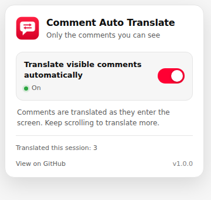

<p align="center">
  
</p>

<h1 align="center">YouTube Auto Translate</h1>

<p align="center">
  Automatically translate YouTube comments as they appear on screen — using YouTube's own translate button.
</p>

<p align="center">
  <a href="README.zh-CN.md">简体中文</a> ·
  <a href="https://github.com/BearingSteel/Ext-youtube-auto-click-translate/releases/latest">Download</a> ·
  <a href="https://github.com/BearingSteel/Ext-youtube-auto-click-translate/issues">Issues</a>
</p>

<p align="center">
  <a href="https://github.com/BearingSteel/Ext-youtube-auto-click-translate/actions/workflows/build.yml"></a>
  <a href="https://github.com/BearingSteel/Ext-youtube-auto-click-translate/actions/workflows/release.yml"></a>
  <a href="LICENSE"></a>
</p>

<p align="center">
  
</p>

---

## What it does

YouTube shows a **Translate** button under comments that are in a different language. Clicking it translates the comment using YouTube's built-in translation.

This extension clicks that button for you, but **only for comments currently visible in the viewport**:

- Load 10 comments, 3 are on screen → those 3 are translated.
- Scroll down and a new comment appears → that comment is translated.
- Scroll past comments quickly → off-screen comments are skipped.
- Comments without a native translate button are left untouched.

The extension does **not** call a translation API, does not need an API key and does not read or upload comment text.

## Features

- ✅ Uses YouTube's native translation — no extra API or subscription
- ✅ Viewport-only triggering via `IntersectionObserver`
- ✅ Handles YouTube's single-page navigation and lazily rendered comments
- ✅ Randomised delay and one-at-a-time clicking to avoid request bursts
- ✅ Popup switch, remembered with `chrome.storage.sync`
- ✅ 15 UI languages: English, 简体中文, 繁體中文, 日本語, 한국어, Español, Français, Deutsch, Português (Brasil), Русский, Italiano, Türkçe, Tiếng Việt, Bahasa Indonesia, العربية
- ✅ Chrome and Microsoft Edge (Chromium) compatible
- ✅ Manifest V3, no remote code, no tracking

## Install

### From a release

1. Download the latest `youtube-auto-click-translate-v*.zip` from [Releases](https://github.com/BearingSteel/Ext-youtube-auto-click-translate/releases/latest).
2. Extract the ZIP to a permanent folder.
3. Open `chrome://extensions` in Chrome, or `edge://extensions` in Edge.
4. Turn on **Developer mode**.
5. Choose **Load unpacked** and select the extracted folder (the folder containing `manifest.json`).
6. Open or refresh a YouTube video page.

### From source

```bash
git clone https://github.com/BearingSteel/Ext-youtube-auto-click-translate.git
cd Ext-youtube-auto-click-translate
npm run build
```

Then load `dist/unpacked` as an unpacked extension.

> After installing or updating the extension, refresh any open YouTube tabs so the content script is loaded.

## Usage

1. Open a YouTube video and scroll to the comments.
2. Click the extension icon.
3. Keep **Translate visible comments automatically** on.
4. Scroll normally. Comments are translated as they enter the screen.

The popup also shows how many comments were triggered in the current page session.

## How it works

`src/content.js`:

1. Finds comment components (`ytd-comment-view-model` / `ytd-comment-renderer`).
2. Observes them with `IntersectionObserver` using the browser viewport.
3. When a comment enters the viewport, locates YouTube's native translate control.
4. Re-checks visibility after a short random delay, then calls `.click()`.
5. Skips comments that are already translated, off-screen or missing the button.
6. Resets on `yt-navigate-finish` so changing videos works correctly.

The translate button is detected primarily by `#translate-button`, with a localised label fallback for English, Simplified/Traditional Chinese, Japanese, Korean, Spanish, French, German, Portuguese, Russian, Italian, Turkish, Vietnamese, Indonesian, Arabic and more.

## Supported button languages

The UI is localised into 15 languages. The button detector includes fallback labels for common YouTube UI languages, including:

`Translate`, `翻译`, `翻譯`, `翻訳`, `번역`, `Traducir`, `Traduire`, `Übersetzen`, `Traduzir`, `Перевести`, `Traduci`, `Çevir`, `Dịch`, `Terjemahkan`, `ترجمة`, `अनुवाद`, `แปล`, `Vertalen`, `Przetłumacz`, `Översätt`, `Přeložit`, `Μετάφραση`, `תרגם`, `Fordítás`, `Käännä`, `Oversett`, `Oversæt`.

## Limitations

- The target language is controlled by **YouTube's UI language**, not by this extension. If you want a different target language, change YouTube's interface language.
- Only comments with YouTube's native translate button can be translated.
- Comments must be rendered by YouTube before the extension can see them; it cannot translate comments that have not loaded yet.
- YouTube changes its DOM regularly. If the button stops being found, open an issue with your YouTube UI language and the page markup if possible.
- The primary target is the standard watch page. Shorts comments use a different layout and are not guaranteed to work.
- Automating clicks in your own browser may be subject to YouTube's terms of service. Use at your own discretion.

## Privacy

- No analytics, tracking, accounts or external servers.
- No comment text is read, stored or transmitted by the extension.
- The only stored value is the on/off switch, saved with `chrome.storage.sync`.
- When a translation is triggered, the request is made by YouTube itself, exactly as if you had clicked the button.

See [PRIVACY.md](PRIVACY.md) for details.

## Development

Requirements: Node.js 18+ (build), Python 3 (only if regenerating icons).

```bash
npm run build     # validate, copy to dist/unpacked, create dist/*.zip
npm run check     # same validation and build
npm run icons     # regenerate PNG icons (requires Python 3)
```

Project layout:

```text
src/
  manifest.json
  content.js
  popup.html / popup.css / popup.js
  _locales/<locale>/messages.json
  icons/
scripts/
  build.mjs
  generate-icons.py
.github/workflows/
  build.yml
  release.yml
```

The build script validates:

- Manifest V3 structure and version
- Every locale has the same message keys
- All `__MSG_*__` and `data-i18n` keys exist
- JavaScript syntax
- Every referenced icon exists

## Release

The `Release` workflow runs when a tag matching `v*` is pushed:

```bash
# Keep src/manifest.json and package.json in sync first
git tag v1.0.0
git push origin v1.0.0
```

It validates that the tag matches the manifest version, builds the ZIP and publishes a GitHub Release with the ZIP attached.

The `Build` workflow runs on every push to `main`, every pull request and manual dispatch, and uploads the built artifact.

## Disclaimer

This project is not affiliated with, endorsed by or sponsored by YouTube or Google. YouTube is a trademark of Google LLC.

## License

[MIT](LICENSE) © 2026 BearingSteel
