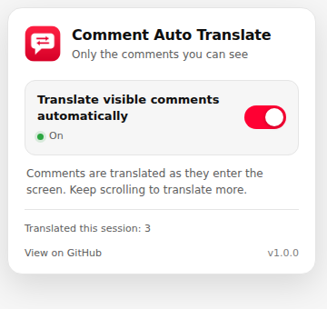

<p align="center">
  
</p>

<h1 align="center">YouTube 评论自动翻译</h1>

<p align="center">
  当评论出现在屏幕上时，自动点击 YouTube 原生的「翻译」按钮。
</p>

<p align="center">
  <a href="README.md">English</a> ·
  <a href="https://github.com/BearingSteel/Ext-youtube-auto-click-translate/releases/latest">下载</a> ·
  <a href="https://github.com/BearingSteel/Ext-youtube-auto-click-translate/issues">问题反馈</a>
</p>

<p align="center">
  <a href="https://github.com/BearingSteel/Ext-youtube-auto-click-translate/actions/workflows/build.yml"></a>
  <a href="https://github.com/BearingSteel/Ext-youtube-auto-click-translate/actions/workflows/release.yml"></a>
  <a href="LICENSE"></a>
</p>

<p align="center">
  
</p>

---

## 功能说明

YouTube 会在其他语言的评论下方显示「翻译」按钮，点击后由 YouTube 自己完成翻译。

本扩展帮你自动点击这个按钮，但**只处理当前屏幕内可见的评论**：

- 页面加载了 10 条评论，屏幕内显示前 3 条 → 只翻译这 3 条。
- 向下滚动，新评论进入屏幕 → 翻译新出现的评论。
- 快速滑过评论 → 已经离开屏幕的评论会被跳过。
- 没有原生「翻译」按钮的评论保持原样。

扩展**不会**调用第三方翻译 API，不需要 API Key，也不会读取或上传评论内容。

## 功能特点

- ✅ 使用 YouTube 原生翻译，无需额外 API 或订阅
- ✅ 通过 `IntersectionObserver` 只在评论进入视口时触发
- ✅ 兼容 YouTube 单页跳转和评论区懒加载
- ✅ 随机延迟、逐条点击，避免瞬间产生大量请求
- ✅ 弹窗开关，使用 `chrome.storage.sync` 记住设置
- ✅ 15 种界面语言：English、简体中文、繁體中文、日本語、한국어、Español、Français、Deutsch、Português (Brasil)、Русский、Italiano、Türkçe、Tiếng Việt、Bahasa Indonesia、العربية
- ✅ 支持 Chrome 和 Microsoft Edge（Chromium）
- ✅ Manifest V3，无远程代码，无追踪

## 安装

### 从 Release 安装

1. 从 [Releases](https://github.com/BearingSteel/Ext-youtube-auto-click-translate/releases/latest) 下载最新的 `youtube-auto-click-translate-v*.zip`。
2. 解压到一个固定文件夹。
3. 在 Chrome 打开 `chrome://extensions`，或在 Edge 打开 `edge://extensions`。
4. 打开右上角的「开发者模式」。
5. 点击「加载已解压的扩展程序」，选择解压后的文件夹（里面有 `manifest.json` 的那一层）。
6. 打开或刷新 YouTube 视频页面。

### 从源码构建

```bash
git clone https://github.com/BearingSteel/Ext-youtube-auto-click-translate.git
cd Ext-youtube-auto-click-translate
npm run build
```

然后在扩展管理页加载 `dist/unpacked`。

> 安装或更新扩展后，请刷新已经打开的 YouTube 页面，让 content script 重新加载。

## 使用方法

1. 打开 YouTube 视频，滚动到评论区。
2. 点击扩展图标。
3. 保持「自动翻译屏幕内的评论」为开启状态。
4. 正常向下滚动，评论进入屏幕时会自动翻译。

弹窗会显示当前页面本次已触发的翻译数量。

## 工作原理

`src/content.js` 会：

1. 查找评论组件（`ytd-comment-view-model` / `ytd-comment-renderer`）。
2. 用 `IntersectionObserver` 以浏览器视口为范围观察评论。
3. 评论进入视口时，找到 YouTube 原生的翻译按钮。
4. 随机延迟后再次确认评论仍在屏幕内，然后调用 `.click()`。
5. 跳过已翻译、已离开屏幕或没有翻译按钮的评论。
6. 监听 `yt-navigate-finish`，切换视频时重置状态。

翻译按钮优先通过 `#translate-button` 识别，并提供英文、简中、繁中、日文、韩文、西班牙文、法文、德文、葡萄牙文、俄文、意大利文、土耳其文、越南文、印尼文、阿拉伯文等语言的文字兜底匹配。

## 支持识别的按钮语言

界面已本地化为 15 种语言。按钮识别还包含以下常见 YouTube 界面语言的兜底：

`Translate`、`翻译`、`翻譯`、`翻訳`、`번역`、`Traducir`、`Traduire`、`Übersetzen`、`Traduzir`、`Перевести`、`Traduci`、`Çevir`、`Dịch`、`Terjemahkan`、`ترجمة`、`अनुवाद`、`แปล`、`Vertalen`、`Przetłumacz`、`Översätt`、`Přeložit`、`Μετάφραση`、`תרגם`、`Fordítás`、`Käännä`、`Oversett`、`Oversæt`。

## 限制

- 翻译目标语言由 **YouTube 界面语言**决定，不由扩展设置。想翻译成其他语言，请切换 YouTube 界面语言。
- 只有带 YouTube 原生翻译按钮的评论才能被翻译。
- 评论必须先由 YouTube 渲染出来，扩展无法翻译尚未加载的评论。
- YouTube 会不定期调整页面结构。如果按钮突然无法识别，欢迎提交 issue，并附上界面语言和页面结构信息。
- 主要面向普通视频播放页。Shorts 的评论区结构不同，不保证可用。
- 自动点击你自己的浏览器页面，可能受到 YouTube 服务条款约束，请自行判断使用。

## 隐私

- 无统计、无追踪、无账号、无外部服务器。
- 扩展不会读取、保存或上传评论内容。
- 唯一保存的数据是开关状态，存放在 `chrome.storage.sync`。
- 翻译请求由 YouTube 自己发出，效果等同于你手动点击翻译按钮。

详情见 [PRIVACY.md](PRIVACY.md)。

## 开发

环境要求：Node.js 18+（构建），Python 3（仅在重新生成图标时需要）。

```bash
npm run build     # 校验、复制到 dist/unpacked、生成 dist/*.zip
npm run check     # 与 build 相同的校验和构建
npm run icons     # 重新生成 PNG 图标（需要 Python 3）
```

目录结构：

```text
src/
  manifest.json
  content.js
  popup.html / popup.css / popup.js
  _locales/<locale>/messages.json
  icons/
scripts/
  build.mjs
  generate-icons.py
.github/workflows/
  build.yml
  release.yml
```

构建脚本会校验：

- Manifest V3 结构和版本号
- 所有语言文件的 key 是否一致
- 所有 `__MSG_*__` 和 `data-i18n` 是否有对应文案
- JavaScript 语法
- 引用的图标文件是否存在

## 发布

推送匹配 `v*` 的 tag 时，`Release` 工作流会自动执行：

```bash
# 先同步 src/manifest.json 和 package.json 的版本号
git tag v1.0.0
git push origin v1.0.0
```

工作流会校验 tag 与 manifest 版本一致，构建 ZIP，并创建附带 ZIP 的 GitHub Release。

`Build` 工作流会在每次推送到 `main`、每个 Pull Request 和手动触发时运行，并上传构建产物。

## 免责声明

本项目与 YouTube、Google 无隶属关系，也未获得其认可或赞助。YouTube 是 Google LLC 的商标。

## 许可证

[MIT](LICENSE) © 2026 BearingSteel
